

  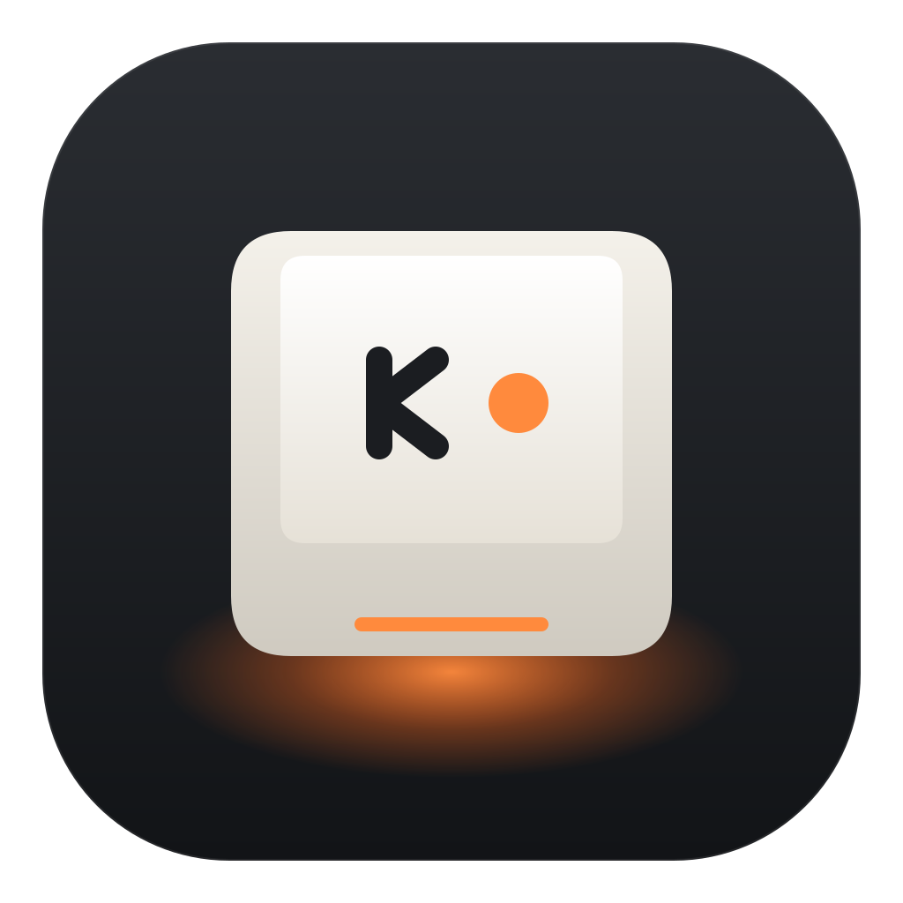

<h1 align="center">Keymotion</h1>

  A free, open-source Windows app for the AJAZZ AK980 PRO keyboard (also sold as AK980 V2): 
  lighting, key mapping, macros and your own GIFs on its little screen. No AJAZZ software needed.

  <b>Have another keyboard?</b> Several from AULA, AJAZZ and LangTu could come next. 
  <a href="#supported-keyboards">Is yours on the list?</a> Plug it in with Keymotion open and tell us what it finds.

  <b>English</b> · <a href="README.tr.md">Türkçe</a> · <a href="README.ru.md">Русский</a> · <a href="README.zh-CN.md">简体中文</a>

  <b>
    <a href="https://cebersaban44-rgb.github.io/keymotion/">User guide</a> ·
    <a href="https://github.com/cebersaban44-rgb/keymotion/releases">Release notes</a> ·
    <a href="https://github.com/cebersaban44-rgb/keymotion/discussions/categories/q-a">Questions</a>
  </b>

  <a href="https://github.com/cebersaban44-rgb/keymotion/releases/latest">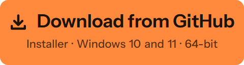</a>
  &nbsp;
  <a href="https://apps.microsoft.com/detail/9NL03GDZZ0ZS?referrer=appbadge&amp;mode=full"><picture><source media="(prefers-color-scheme: dark)" srcset="https://get.microsoft.com/images/en-us%20light.svg"></picture></a>

  Free · Unofficial, not affiliated with AJAZZ · The same app either way: Microsoft signs the Store copy, while the GitHub installer isn't code-signed yet, so Windows may warn before it runs: <a href="#download-and-install">which to choose</a>

  
  
  
  

  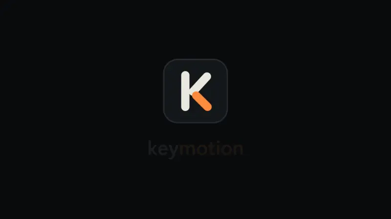
   
  Keyboard scenes rendered with AI; the app's pages and what the keyboard's screen shows are real.
   
  <b>The 36-second video with sound: <a href="https://youtu.be/LvGvyJFhPIE">on YouTube</a></b>

  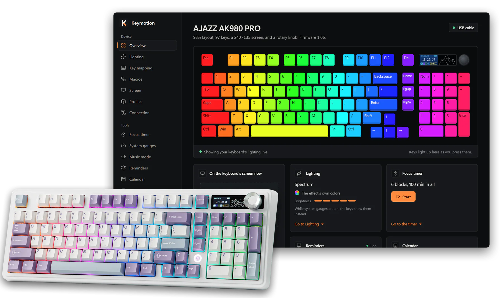

## Supported keyboards

Keymotion is tested on the AJAZZ AK980 PRO. Other keyboards built on the same platform could come next, and if you have one, you can help add it.

### Tested and working

| | Keyboard | USB cable | 2.4 GHz receiver | Bluetooth |
|---|---|---|---|---|
| 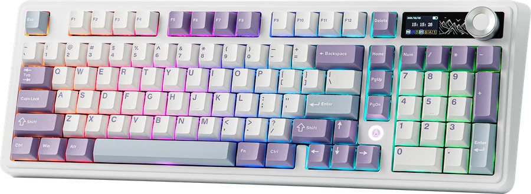 | **AJAZZ AK980 PRO** also sold as AK980 V2 | Everything | Typing, media keys and the knob | Typing, media keys, the knob and the battery level |

Settings travel over the USB cable: that is how the keyboard is built.

### Same platform, not tested yet

According to other open-source projects that measured them on real keyboards, these appear to use the same commands as the AK980 PRO. Keymotion doesn't work with them yet: a keyboard is added only after someone has tried it, because the limits that keep it safe differ from model to model.

Have one? Here's how to help:

1. [Download Keymotion](https://github.com/cebersaban44-rgb/keymotion/releases/latest) and connect the keyboard with its USB cable.
2. If Keymotion says **This keyboard isn't supported yet**, select **Request support**. It copies the keyboard's details and writes nothing to the keyboard.
3. Select **Tell us** next to your keyboard below and paste the details. With them we can prepare a test build for you to try.

| Keyboard | Screen | Status | Have one? |
|---|---|---|---|
| **AULA F108 Pro** also EPOMAKER x AULA F108 Pro · the closest relative | 240×135 | Not tested yet | [Tell us][f108] |
| **AULA NOVA75** | 240×135 | Not tested yet | [Tell us][nova75] |
| **AULA F75 Max** also EPOMAKER x AULA F75 Max | 128×128 | Not tested yet | [Tell us][f75max] |
| **AULA EA75 Max** | 135×240, upright | Not tested yet | [Tell us][ea75max] |
| **AULA S75 Pro** | 135×240, upright | Not tested yet | [Tell us][s75pro] |
| **AULA F98 Pro** | 1.14 inch | Not tested yet | [Tell us][f98pro] |
| **AJAZZ AK820 Pro** the version with the SONiX program; also EPOMAKER AK820 Pro | 128×128 | Not tested yet | [Tell us][ak820pro] |
| **AJAZZ AK820 MAX / MAX PLUS** the version with a SONiX screen | 128×128 | Not tested yet | [Tell us][ak820max] |
| **AJAZZ AK35I V3 MAX** | 240×135 | Not tested yet | [Tell us][ak35i] |
| **AJAZZ AKS075** | 128×128 | Not tested yet | [Tell us][aks075] |
| **AJAZZ AK650 / AK650 Pro** | 0.85 inch | Not tested yet | [Tell us][ak650] |
| **AJAZZ AK980** without a screen | None | Not tested yet | [Tell us][ak980] |
| **LangTu LT-104** | 160×80 | Not tested yet | [Tell us][lt104] |

Not on the list? Plug it in anyway and [tell us about it](https://github.com/cebersaban44-rgb/keymotion/issues/new?template=keyboard.yml). The [supported keyboards page](https://cebersaban44-rgb.github.io/keymotion/help/keyboards/) has what is known about each model, the keyboards that look alike but are different inside, and how a keyboard moves from **Not tested yet** to **Works**.

What we know about these keyboards comes from other open-source projects that measured them, among them OpenKey, sonix-keyboard-studio, ak820pro-modder and OpenRGB. Product names are used only to say which hardware this is about; Keymotion isn't affiliated with any of these brands.

[f108]: https://github.com/cebersaban44-rgb/keymotion/issues/new?template=keyboard.yml&title=%5BKeyboard%5D+AULA+F108+Pro&model=AULA+F108+Pro
[nova75]: https://github.com/cebersaban44-rgb/keymotion/issues/new?template=keyboard.yml&title=%5BKeyboard%5D+AULA+NOVA75&model=AULA+NOVA75
[f75max]: https://github.com/cebersaban44-rgb/keymotion/issues/new?template=keyboard.yml&title=%5BKeyboard%5D+AULA+F75+Max&model=AULA+F75+Max
[ea75max]: https://github.com/cebersaban44-rgb/keymotion/issues/new?template=keyboard.yml&title=%5BKeyboard%5D+AULA+EA75+Max&model=AULA+EA75+Max
[s75pro]: https://github.com/cebersaban44-rgb/keymotion/issues/new?template=keyboard.yml&title=%5BKeyboard%5D+AULA+S75+Pro&model=AULA+S75+Pro
[f98pro]: https://github.com/cebersaban44-rgb/keymotion/issues/new?template=keyboard.yml&title=%5BKeyboard%5D+AULA+F98+Pro&model=AULA+F98+Pro
[ak820pro]: https://github.com/cebersaban44-rgb/keymotion/issues/new?template=keyboard.yml&title=%5BKeyboard%5D+AJAZZ+AK820+Pro&model=AJAZZ+AK820+Pro
[ak820max]: https://github.com/cebersaban44-rgb/keymotion/issues/new?template=keyboard.yml&title=%5BKeyboard%5D+AJAZZ+AK820+MAX&model=AJAZZ+AK820+MAX
[ak35i]: https://github.com/cebersaban44-rgb/keymotion/issues/new?template=keyboard.yml&title=%5BKeyboard%5D+AJAZZ+AK35I+V3+MAX&model=AJAZZ+AK35I+V3+MAX
[aks075]: https://github.com/cebersaban44-rgb/keymotion/issues/new?template=keyboard.yml&title=%5BKeyboard%5D+AJAZZ+AKS075&model=AJAZZ+AKS075
[ak650]: https://github.com/cebersaban44-rgb/keymotion/issues/new?template=keyboard.yml&title=%5BKeyboard%5D+AJAZZ+AK650&model=AJAZZ+AK650
[ak980]: https://github.com/cebersaban44-rgb/keymotion/issues/new?template=keyboard.yml&title=%5BKeyboard%5D+AJAZZ+AK980+%28no+screen%29&model=AJAZZ+AK980+%28no+screen%29
[lt104]: https://github.com/cebersaban44-rgb/keymotion/issues/new?template=keyboard.yml&title=%5BKeyboard%5D+LangTu+LT-104&model=LangTu+LT-104

## What it does

| | |
|---|---|
| 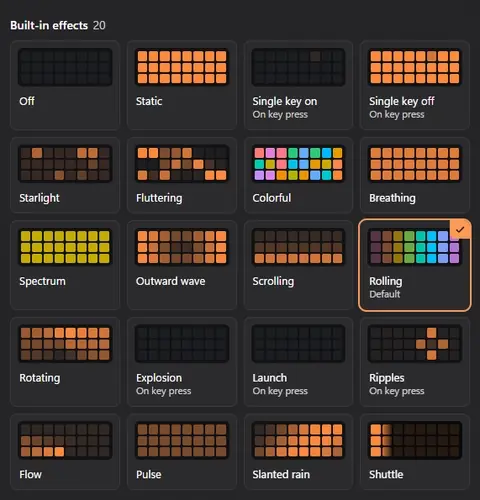 | **Lighting** The keyboard's 19 effects, a color for every key, and a live mirror of what the keys show. |
| 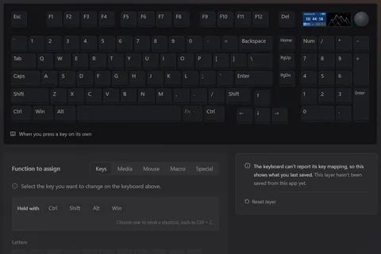 | **Key mapping** Change any key on the base and Fn layers: shortcuts, media keys, mouse buttons. |
| 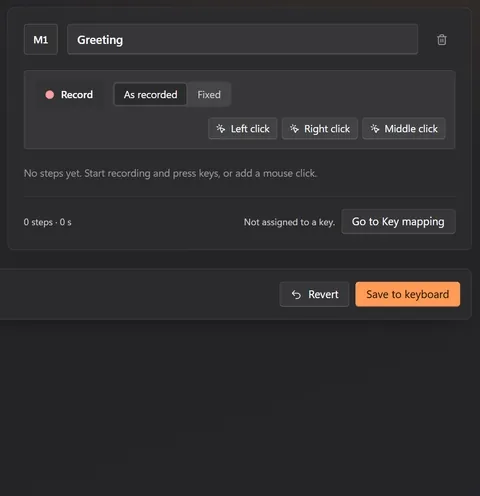 | **Macros** Record a sequence by pressing keys, then edit each step and its timing. |
| 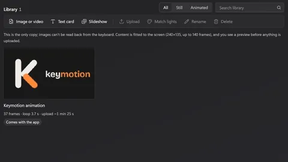 | **Screen studio** Put images, GIFs, videos and text cards on the 240×135 screen. |
| 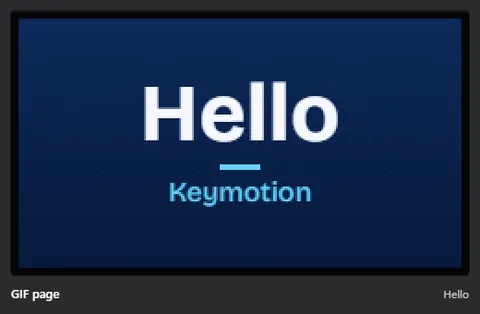 | **Live screen** Cards that update on their own: the song that is playing, your next meeting, the focus timer. |
| 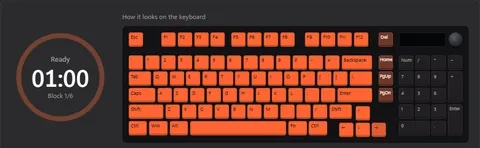 | **Focus and reminders** A focus timer, reminders and system gauges that light up on the keys. |
| 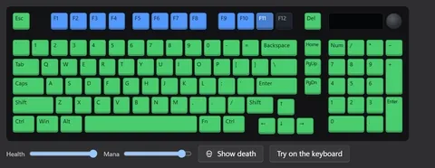 | **Game session** Notices when you play: a card on the screen when a game starts and a summary when it ends, and the game's keys lit. In League of Legends, your health, mana and the match's events show on the keys. |
| 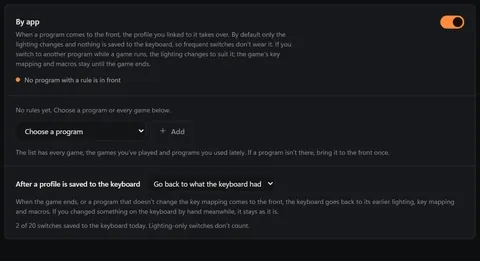 | **Profiles by app** Keep lighting, keys and macros as profiles. Each program, or every game, switches to its own when it comes to the front. |

The [user guide](https://cebersaban44-rgb.github.io/keymotion/) goes through every page of the app.

## Download and install

Keymotion comes two ways. It is the same app, with the same version and the same release notes, for Windows 10 and 11 (64-bit). Install one of them.

| | Microsoft Store | GitHub |
|---|---|---|
| Get it | [Keymotion in the Microsoft Store](https://apps.microsoft.com/detail/9NL03GDZZ0ZS?referrer=appbadge&mode=full) | `Keymotion_<version>_x64-setup.exe` from the [latest release](https://github.com/cebersaban44-rgb/keymotion/releases/latest) |
| Signed | Yes, by Microsoft: Windows installs it without a warning | Not yet: Windows may warn before it runs |
| Updates | The Microsoft Store | Keymotion checks GitHub and asks before installing |
| Test versions | No | Yes |

We suggest the Microsoft Store. Choose GitHub if your computer has no Microsoft Store (Windows LTSC, or a work PC where it is turned off), or to try test versions.

**From the Microsoft Store**

1. Open [Keymotion in the Microsoft Store](https://apps.microsoft.com/detail/9NL03GDZZ0ZS?referrer=appbadge&mode=full) and select **Get**.
2. Connect the keyboard with the USB cable and set the switch on its back to the middle (USB).

**From GitHub**

1. Download the installer, `Keymotion_<version>_x64-setup.exe`, from the [latest release](https://github.com/cebersaban44-rgb/keymotion/releases/latest). The release page lists its SHA-256.
2. Run it and follow the steps.
3. Connect the keyboard with the USB cable and set the switch on its back to the middle (USB).

> [!NOTE]
> The GitHub installer isn't signed yet, so Windows may say "Windows protected your PC". Select **More info**, then **Run anyway**. If Smart App Control is on, Windows may block it outright; the Microsoft Store copy installs without either. See the [code signing policy](#code-signing-policy).

Good to know before you install:

- Keymotion is unofficial. It isn't made, endorsed or supported by AJAZZ.
- Both are built by GitHub Actions from the code in this repository: the installer, whose SHA-256 the release page lists, and the Microsoft Store package, which Microsoft checks and signs.
- On VirusTotal, 70 of 71 antivirus engines find nothing in the 0.1.0 installer. One machine-learning engine flags it as a new, unsigned file; we've reported it as a false positive. [Details](https://cebersaban44-rgb.github.io/keymotion/about/code-signing/#antivirus-scans).
- It collects no usage data, and it never updates the keyboard's firmware.

Updates: the Microsoft Store updates its copy. The copy from GitHub checks GitHub for a new version once a day and asks before installing it; you can turn the check off in Settings.

## Safety

Keymotion only sends commands that were measured on a real keyboard, and firmware and bootloader updates are blocked in the code. Lighting, key assignments, macros and screen pictures are saved in the keyboard's memory, and you can always go back: [If something goes wrong](https://cebersaban44-rgb.github.io/keymotion/help/recovery/) shows how.

## Privacy

Keymotion collects nothing about you. It goes online for two things only: your calendar, if you add one, and a daily update check on GitHub, which you can turn off. Read the [privacy policy](PRIVACY.md).

## How Keymotion is made

I made Keymotion with Claude, an AI coding assistant. Claude wrote most of the code; I decided what it should do and tried every feature on my own AK980 PRO before it went in. Every change goes through a pull request and the automatic checks. Everything that talks to the keyboard was measured on the real keyboard first, and commands that could harm it are blocked in the code.

## Code signing policy

The installer on GitHub isn't signed yet. SignPath Foundation, which signs open-source projects for free, declined our application of 15 November 2026 for now because the project is still new; we'll apply again. Keymotion is also in the [Microsoft Store](https://apps.microsoft.com/detail/9NL03GDZZ0ZS?referrer=appbadge&mode=full), where Microsoft signs it.

- Releases are built from this repository by GitHub Actions ([release workflow](.github/workflows/release.yml)).
- Committers and reviewers: [@cebersaban44-rgb](https://github.com/cebersaban44-rgb)
- Approvers: [@cebersaban44-rgb](https://github.com/cebersaban44-rgb)
- Privacy: see the [privacy policy](PRIVACY.md).

The full policy: [Code signing policy](https://cebersaban44-rgb.github.io/keymotion/about/code-signing/).

## Contributing

Bug reports, keyboard requests and ideas are welcome:

- [Report a bug](https://github.com/cebersaban44-rgb/keymotion/issues/new?template=bug.yml)
- [Ask for another keyboard](https://github.com/cebersaban44-rgb/keymotion/issues/new?template=keyboard.yml)
- [Questions and ideas](https://github.com/cebersaban44-rgb/keymotion/discussions)
- [Report a security problem privately](SECURITY.md)

Before you open a pull request, read [CONTRIBUTING.md](CONTRIBUTING.md).

## License

Keymotion is licensed under either of the [Apache License, Version 2.0](LICENSE-APACHE) or the [MIT license](LICENSE-MIT), at your option. Third-party software in the app is listed in [app/public/third-party-notices.txt](app/public/third-party-notices.txt).

Keymotion is an independent project. It is not affiliated with, endorsed by or supported by AJAZZ, AULA or any other keyboard brand named here. Product names are used only to say which hardware this software works with. See [NOTICE](NOTICE).

Keymotion isn't endorsed by Riot Games and doesn't reflect the views or opinions of Riot Games or anyone officially involved in producing or managing Riot Games properties. Riot Games, and all associated properties are trademarks or registered trademarks of Riot Games, Inc.
