

  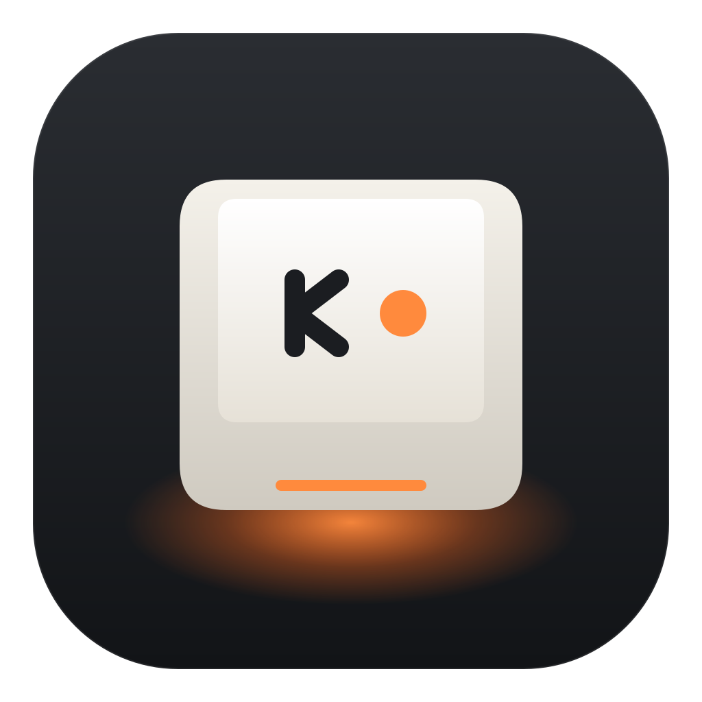

<h1 align="center">Keymotion</h1>

  Бесплатное приложение для Windows с открытым исходным кодом для клавиатуры AJAZZ AK980 PRO (также продаётся как AK980 V2): 
  подсветка, назначение клавиш, макросы и ваши собственные GIF на её маленьком экране. Программа AJAZZ не нужна.

  <b>У вас другая клавиатура?</b> Следующими могут стать несколько моделей AULA, AJAZZ и LangTu. 
  <a href="#поддерживаемые-клавиатуры">Есть ли ваша в списке?</a> Подключите её при открытом приложении Keymotion и сообщите нам, что оно обнаружит.

  <a href="README.md">English</a> · <a href="README.tr.md">Türkçe</a> · <b>Русский</b> · <a href="README.zh-CN.md">简体中文</a>

  Русская версия переведена с помощью ИИ. Если вы заметили ошибку в переводе, <a href="https://github.com/cebersaban44-rgb/keymotion/issues/new?template=docs.yml">сообщите о ней</a>.

  <b>
    <a href="https://cebersaban44-rgb.github.io/keymotion/ru/">Руководство пользователя</a> ·
    <a href="https://github.com/cebersaban44-rgb/keymotion/releases">Заметки о выпуске</a> ·
    <a href="https://github.com/cebersaban44-rgb/keymotion/discussions/categories/q-a">Вопросы</a>
  </b>

  <a href="https://github.com/cebersaban44-rgb/keymotion/releases/latest">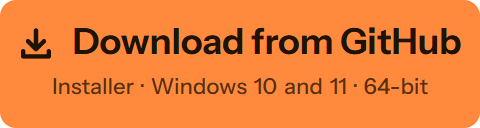</a>
  &nbsp;
  <a href="https://apps.microsoft.com/detail/9NL03GDZZ0ZS?referrer=appbadge&amp;mode=full"><picture><source media="(prefers-color-scheme: dark)" srcset="https://get.microsoft.com/images/ru%20light.svg"></picture></a>

  Бесплатно · Неофициальное приложение, не связанное с AJAZZ · В обоих случаях это одно и то же приложение: копию из Store подписывает Microsoft, а установщик с GitHub пока не подписан, поэтому перед запуском Windows может показать предупреждение: <a href="#скачивание-и-установка">что выбрать</a>

  
  
  
  

  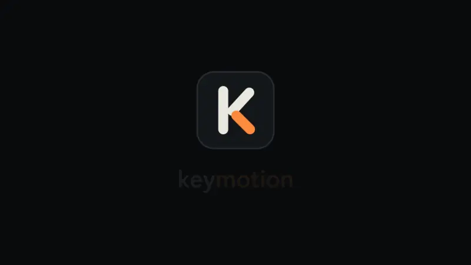
   
  Сцены с клавиатурой созданы с помощью ИИ; страницы приложения и то, что показывает экран клавиатуры, — настоящие.
   
  <b>36-секундное видео со звуком (на английском): <a href="https://youtu.be/LvGvyJFhPIE">на YouTube</a></b>

  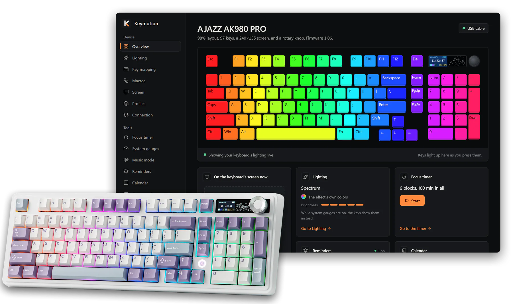

## Поддерживаемые клавиатуры

Работа Keymotion проверена на клавиатуре AJAZZ AK980 PRO. Следующими могут стать другие клавиатуры на той же платформе. Если у вас есть такая, вы можете помочь её добавить.

### Проверено и работает

| | Клавиатура | USB-кабель | Приёмник 2,4 ГГц | Bluetooth |
|---|---|---|---|---|
| 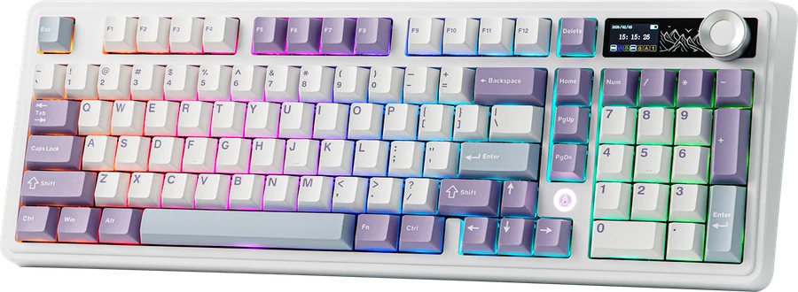 | **AJAZZ AK980 PRO** также продаётся как AK980 V2 | Всё | Набор текста, мультимедийные клавиши и регулятор | Набор текста, мультимедийные клавиши, регулятор и уровень заряда |

Настройки передаются через USB-кабель — так устроена клавиатура.

> [!NOTE]
> Новейшая прошивка AJAZZ для AK980 PRO, 3.01 («AK980 Led v2 Firmware 769»), использует другой набор команд, который Keymotion пока не поддерживает, а вернуться на старую прошивку AJAZZ не позволяет. Если хотите и дальше пользоваться Keymotion сейчас, подождите с обновлением. [Подробнее в вопросах и ответах](https://cebersaban44-rgb.github.io/keymotion/ru/help/faq/#стоит-ли-устанавливать-новейшую-прошивку-ajazz).

### Та же платформа, ещё не проверены

По данным других проектов с открытым исходным кодом, которые исследовали эти клавиатуры на настоящих устройствах, они, по-видимому, используют те же команды, что и AK980 PRO. Пока Keymotion с ними не работает: клавиатура добавляется только после того, как кто-то её проверит, потому что ограничения, которые обеспечивают её безопасность, у каждой модели свои.

У вас есть одна из них? Вот как помочь:

1. [Скачайте Keymotion](https://github.com/cebersaban44-rgb/keymotion/releases/latest) и подключите клавиатуру USB-кабелем.
2. Если появится сообщение **Эта клавиатура пока не поддерживается**, выберите **Запросить поддержку**. Так вы скопируете сведения о клавиатуре; в саму клавиатуру ничего не записывается.
3. Ниже, рядом с вашей клавиатурой, выберите **Сообщить** и вставьте эти сведения. Форму можно заполнить по-русски. По этим сведениям мы сможем подготовить тестовую сборку, чтобы вы её попробовали.

| Клавиатура | Экран | Статус | Есть у вас? |
|---|---|---|---|
| **AULA F108 Pro** также EPOMAKER x AULA F108 Pro · самая близкая родственная модель | 240×135 | Пока не проверена | [Сообщить][f108] |
| **AULA NOVA75** | 240×135 | Пока не проверена | [Сообщить][nova75] |
| **AULA F75 Max** также EPOMAKER x AULA F75 Max | 128×128 | Пока не проверена | [Сообщить][f75max] |
| **AULA EA75 Max** | 135×240, вертикальный | Пока не проверена | [Сообщить][ea75max] |
| **AULA S75 Pro** | 135×240, вертикальный | Пока не проверена | [Сообщить][s75pro] |
| **AULA F98 Pro** | 1,14 дюйма | Пока не проверена | [Сообщить][f98pro] |
| **AJAZZ AK820 Pro** версия с программой SONiX; также EPOMAKER AK820 Pro | 128×128 | Пока не проверена | [Сообщить][ak820pro] |
| **AJAZZ AK820 MAX / MAX PLUS** версия с экраном SONiX | 128×128 | Пока не проверена | [Сообщить][ak820max] |
| **AJAZZ AK35I V3 MAX** | 240×135 | Пока не проверена | [Сообщить][ak35i] |
| **AJAZZ AKS075** | 128×128 | Пока не проверена | [Сообщить][aks075] |
| **AJAZZ AK650 / AK650 Pro** | 0,85 дюйма | Пока не проверена | [Сообщить][ak650] |
| **AJAZZ AK980** без экрана | Нет | Пока не проверена | [Сообщить][ak980] |
| **LangTu LT-104** | 160×80 | Пока не проверена | [Сообщить][lt104] |

Вашей клавиатуры нет в списке? Всё равно подключите её и [расскажите нам о ней](https://github.com/cebersaban44-rgb/keymotion/issues/new?template=keyboard.yml). На [странице поддерживаемых клавиатур](https://cebersaban44-rgb.github.io/keymotion/ru/help/keyboards/) собрано то, что известно о каждой модели, о клавиатурах, которые выглядят одинаково, но внутри устроены по-разному, и о том, как клавиатура переходит из статуса **Пока не проверена** в статус **Работает**.

Сведения об этих клавиатурах взяты из других проектов с открытым исходным кодом, которые их исследовали, среди них OpenKey, sonix-keyboard-studio, ak820pro-modder и OpenRGB. Названия продуктов используются только для того, чтобы указать, о каком оборудовании идёт речь; проект Keymotion не связан ни с одним из этих брендов.

[f108]: https://github.com/cebersaban44-rgb/keymotion/issues/new?template=keyboard.yml&title=%5BKeyboard%5D+AULA+F108+Pro&model=AULA+F108+Pro
[nova75]: https://github.com/cebersaban44-rgb/keymotion/issues/new?template=keyboard.yml&title=%5BKeyboard%5D+AULA+NOVA75&model=AULA+NOVA75
[f75max]: https://github.com/cebersaban44-rgb/keymotion/issues/new?template=keyboard.yml&title=%5BKeyboard%5D+AULA+F75+Max&model=AULA+F75+Max
[ea75max]: https://github.com/cebersaban44-rgb/keymotion/issues/new?template=keyboard.yml&title=%5BKeyboard%5D+AULA+EA75+Max&model=AULA+EA75+Max
[s75pro]: https://github.com/cebersaban44-rgb/keymotion/issues/new?template=keyboard.yml&title=%5BKeyboard%5D+AULA+S75+Pro&model=AULA+S75+Pro
[f98pro]: https://github.com/cebersaban44-rgb/keymotion/issues/new?template=keyboard.yml&title=%5BKeyboard%5D+AULA+F98+Pro&model=AULA+F98+Pro
[ak820pro]: https://github.com/cebersaban44-rgb/keymotion/issues/new?template=keyboard.yml&title=%5BKeyboard%5D+AJAZZ+AK820+Pro&model=AJAZZ+AK820+Pro
[ak820max]: https://github.com/cebersaban44-rgb/keymotion/issues/new?template=keyboard.yml&title=%5BKeyboard%5D+AJAZZ+AK820+MAX&model=AJAZZ+AK820+MAX
[ak35i]: https://github.com/cebersaban44-rgb/keymotion/issues/new?template=keyboard.yml&title=%5BKeyboard%5D+AJAZZ+AK35I+V3+MAX&model=AJAZZ+AK35I+V3+MAX
[aks075]: https://github.com/cebersaban44-rgb/keymotion/issues/new?template=keyboard.yml&title=%5BKeyboard%5D+AJAZZ+AKS075&model=AJAZZ+AKS075
[ak650]: https://github.com/cebersaban44-rgb/keymotion/issues/new?template=keyboard.yml&title=%5BKeyboard%5D+AJAZZ+AK650&model=AJAZZ+AK650
[ak980]: https://github.com/cebersaban44-rgb/keymotion/issues/new?template=keyboard.yml&title=%5BKeyboard%5D+AJAZZ+AK980+%28no+screen%29&model=AJAZZ+AK980+%28no+screen%29
[lt104]: https://github.com/cebersaban44-rgb/keymotion/issues/new?template=keyboard.yml&title=%5BKeyboard%5D+LangTu+LT-104&model=LangTu+LT-104

## Возможности

| | |
|---|---|
| 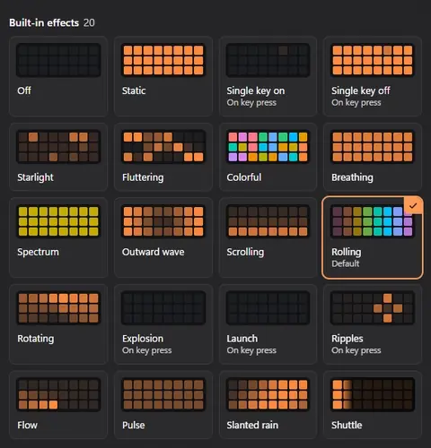 | **Подсветка** 19 эффектов клавиатуры, свой цвет для каждой клавиши и отображение того, что показывают клавиши, в реальном времени. |
| 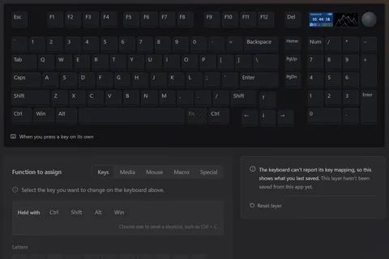 | **Назначение клавиш** Меняйте любую клавишу на основном слое и слое Fn: сочетания клавиш, мультимедийные клавиши, кнопки мыши. |
| 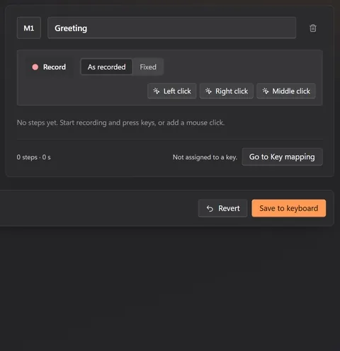 | **Макросы** Запишите последовательность, нажимая клавиши, затем измените каждый шаг и его задержку. |
| 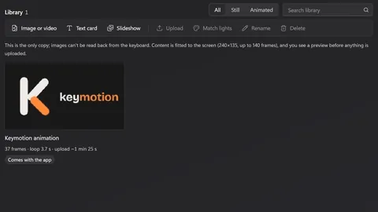 | **Студия экрана** Выводите изображения, GIF, видео и текстовые карточки на экран 240×135. |
| 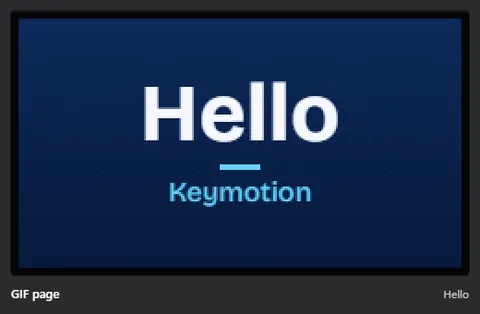 | **Живой экран** Карточки, которые обновляются сами: песня, которая сейчас играет, ваша следующая встреча, таймер фокусировки. |
| 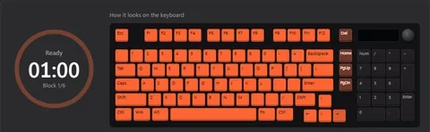 | **Фокусировка и напоминания** Таймер фокусировки, напоминания и системные показатели, которые светятся на клавишах. |
| 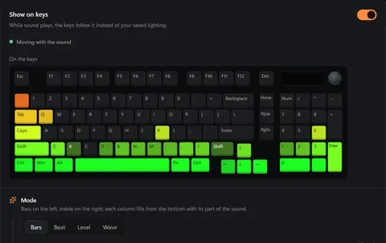 | **Музыкальный режим** Подсветка клавиш, которая движется в такт звуку компьютера: столбцы от басов до высоких частот, вспышка на каждом ударе, полоса громкости или волны. Ничего не записывается, микрофон не используется. |
| 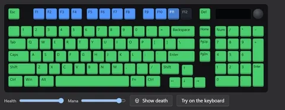 | **Игровая сессия** Keymotion замечает, когда вы играете: карточка на экране, когда игра начинается, итоги, когда она заканчивается, и подсветка клавиш игры. В League of Legends ваше здоровье, мана и события матча отображаются на клавишах. |
| 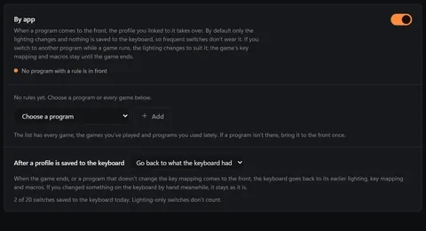 | **Профили по приложениям** Храните подсветку, клавиши и макросы в профилях. Отдельная программа или все игры сразу могут получить свой профиль: он включается, когда программа или игра выходит на передний план. |
| 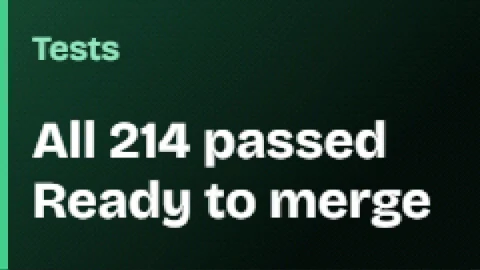 | **ИИ-агенты для программирования** Claude Code и Codex сообщают подсветкой, когда заканчивают задачу, ждут вашего подтверждения или сталкиваются с ошибкой; агент может и писать на клавишах, и отправить карточку на экран. [Подробнее ниже](#ии-агенты-для-программирования). |

[Руководство пользователя](https://cebersaban44-rgb.github.io/keymotion/ru/) подробно описывает каждую страницу приложения.

## ИИ-агенты для программирования

Когда Claude Code или Codex заканчивает задачу, ждёт вашего подтверждения или сталкивается с ошибкой, клавиатура может сообщить об этом подсветкой. Агент может и сам подсвечивать клавиши по-своему: слово на буквенных клавишах, индикатор выполнения на ряду F. Это включается один раз на странице **Инструменты › ИИ-агенты**: Keymotion показывает, что добавит в каждое приложение для программирования, и подключает их после вашего подтверждения.

Агенты общаются с Keymotion через `keymotion-cli`, инструмент командной строки, который входит в приложение. Он никогда не открывает клавиатуру сам, работает только для вашей учётной записи Windows на этом компьютере и ничего не делает, пока вы не включите доступ для агентов. Подробнее в [руководстве по ИИ-агентам](https://cebersaban44-rgb.github.io/keymotion/ru/guide/ai-agents/); команды описаны на странице [Командная строка для агентов](https://cebersaban44-rgb.github.io/keymotion/ru/developers/agent-cli/).

## Скачивание и установка

Keymotion можно получить двумя способами. Это одно и то же приложение, с тем же номером версии и теми же заметками о выпуске, для 64-разрядных Windows 10 и 11. Установите один из вариантов.

| | Microsoft Store | GitHub |
|---|---|---|
| Где взять | [Keymotion в Microsoft Store](https://apps.microsoft.com/detail/9NL03GDZZ0ZS?referrer=appbadge&mode=full) | `Keymotion_<версия>_x64-setup.exe` со страницы [последнего выпуска](https://github.com/cebersaban44-rgb/keymotion/releases/latest) |
| Подпись | Да, от Microsoft: Windows устанавливает приложение без предупреждения | Пока нет: перед запуском Windows может показать предупреждение |
| Обновления | Через Microsoft Store | Keymotion проверяет GitHub и спрашивает перед установкой |
| Тестовые версии | Нет | Да |

Мы рекомендуем Microsoft Store. Выберите GitHub, если на компьютере нет Microsoft Store (Windows LTSC или рабочий компьютер, где он отключён) или если хотите попробовать тестовые версии.

**Из Microsoft Store**

1. Откройте [Keymotion в Microsoft Store](https://apps.microsoft.com/detail/9NL03GDZZ0ZS?referrer=appbadge&mode=full) и выберите **Получить**.
2. Подключите клавиатуру USB-кабелем и переведите переключатель на задней панели в среднее положение (USB).

**С GitHub**

1. Скачайте установщик `Keymotion_<версия>_x64-setup.exe` со страницы [последнего выпуска](https://github.com/cebersaban44-rgb/keymotion/releases/latest). На этой же странице указана его контрольная сумма SHA-256.
2. Запустите его и следуйте инструкциям.
3. Подключите клавиатуру USB-кабелем и переведите переключатель на задней панели в среднее положение (USB).

> [!NOTE]
> Установщик с GitHub пока не подписан, поэтому Windows может показать сообщение «Система Windows защитила ваш компьютер». Выберите **Подробнее**, затем **Выполнить в любом случае**. Если включено интеллектуальное управление приложениями, Windows может полностью заблокировать установщик; копия из Microsoft Store устанавливается без предупреждения и без блокировки. См. раздел [Политика подписи кода](#политика-подписи-кода-code-signing-policy).

Что полезно знать перед установкой:

- Keymotion — неофициальное приложение. Компания AJAZZ его не создавала, не одобряла и не поддерживает.
- Обе копии собираются с помощью GitHub Actions из кода этого репозитория: и установщик, контрольная сумма SHA-256 которого указана на странице выпуска, и пакет для Microsoft Store, который Microsoft проверяет и подписывает.
- На VirusTotal 70 из 71 антивируса ничего не находят в установщике версии 0.1.0. Один антивирус, использующий машинное обучение, помечает его как новый файл без подписи; мы сообщили об этом как о ложном срабатывании. [Подробнее](https://cebersaban44-rgb.github.io/keymotion/ru/about/code-signing/#проверка-антивирусами).
- Приложение не собирает данные об использовании и никогда не обновляет прошивку клавиатуры.

Обновления: копию из Microsoft Store обновляет сам Microsoft Store. Копия с GitHub раз в день проверяет, нет ли на GitHub новой версии, и спрашивает перед её установкой; эту проверку можно отключить в разделе «Настройки».

## Безопасность

Keymotion отправляет только те команды, которые были проверены на настоящей клавиатуре, а обновления прошивки и загрузчика заблокированы в коде. Подсветка, назначения клавиш, макросы и изображения для экрана сохраняются в памяти клавиатуры, и к прежнему состоянию всегда можно вернуться: как это сделать, описано на странице [Если что-то пошло не так](https://cebersaban44-rgb.github.io/keymotion/ru/help/recovery/).

## Конфиденциальность

Keymotion не собирает о вас никаких данных. Приложение выходит в интернет только для двух целей: чтобы получать ваш календарь, если вы его добавили, и чтобы раз в день проверять обновления на GitHub (эту проверку можно отключить). Прочитайте [политику конфиденциальности](https://cebersaban44-rgb.github.io/keymotion/ru/about/privacy/).

## Как создаётся Keymotion

Я создаю Keymotion вместе с Claude — ИИ-помощником для программирования. Большая часть кода написана Claude; я решаю, что должно делать приложение, и проверяю каждую функцию на своей AK980 PRO, прежде чем её добавить. Каждое изменение проходит через запрос на слияние (pull request) и автоматические проверки. Всё, что взаимодействует с клавиатурой, сначала было изучено на настоящей клавиатуре, а команды, которые могут ей навредить, заблокированы в коде.

## Политика подписи кода (Code signing policy)

Установщик на GitHub пока не подписан. Фонд SignPath Foundation, который бесплатно подписывает проекты с открытым исходным кодом, пока отклонил нашу заявку от 15 ноября 2026 года, потому что проект ещё новый; мы подадим её снова. Кроме того, Keymotion есть в [Microsoft Store](https://apps.microsoft.com/detail/9NL03GDZZ0ZS?referrer=appbadge&mode=full), а копию оттуда подписывает Microsoft.

- Выпуски собираются из этого репозитория с помощью GitHub Actions ([рабочий процесс выпуска](.github/workflows/release.yml)).
- Авторы и рецензенты изменений: [@cebersaban44-rgb](https://github.com/cebersaban44-rgb)
- Утверждающие: [@cebersaban44-rgb](https://github.com/cebersaban44-rgb)
- Конфиденциальность: см. [политику конфиденциальности](https://cebersaban44-rgb.github.io/keymotion/ru/about/privacy/).

Полный текст политики: [Политика подписи кода](https://cebersaban44-rgb.github.io/keymotion/ru/about/code-signing/).

## Участие в проекте

Мы рады сообщениям об ошибках, запросам на поддержку клавиатур и идеям. Можно писать по-русски:

- [Сообщить об ошибке](https://github.com/cebersaban44-rgb/keymotion/issues/new?template=bug.yml)
- [Попросить поддержку другой клавиатуры](https://github.com/cebersaban44-rgb/keymotion/issues/new?template=keyboard.yml)
- [Вопросы и идеи](https://github.com/cebersaban44-rgb/keymotion/discussions)
- [Конфиденциально сообщить о проблеме безопасности](SECURITY.md)

Прежде чем открыть запрос на слияние, прочитайте [CONTRIBUTING.md](CONTRIBUTING.md) (на английском).

## Лицензия

Keymotion распространяется по [лицензии Apache версии 2.0](LICENSE-APACHE) или по [лицензии MIT](LICENSE-MIT) — на ваш выбор. Стороннее программное обеспечение, входящее в приложение, перечислено в файле [app/public/third-party-notices.txt](app/public/third-party-notices.txt).

Keymotion — независимый проект. Он не связан с AJAZZ, AULA или другими упомянутыми здесь брендами клавиатур, не одобрен и не поддерживается ими. Названия продуктов используются только для того, чтобы указать, с каким оборудованием работает эта программа. См. файл [NOTICE](NOTICE).

Примечание, которого Riot Games требует для подсветки League of Legends:

Keymotion isn't endorsed by Riot Games and doesn't reflect the views or opinions of Riot Games or anyone officially involved in producing or managing Riot Games properties. Riot Games, and all associated properties are trademarks or registered trademarks of Riot Games, Inc.
