

  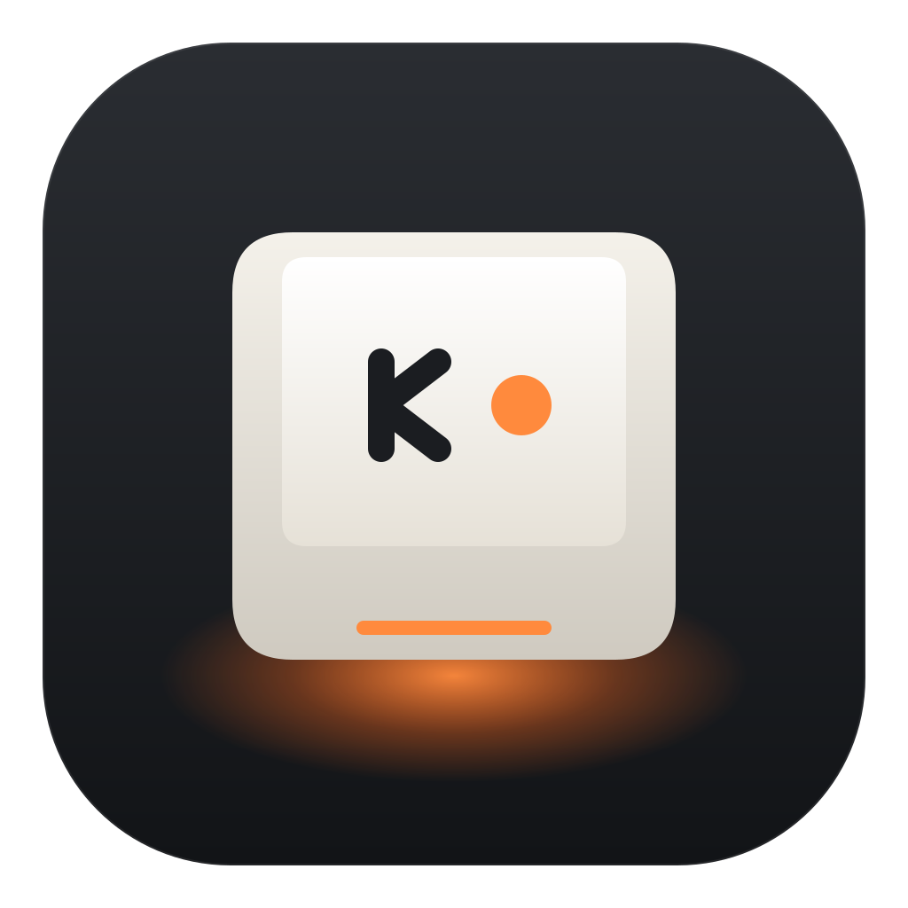

<h1 align="center">Keymotion</h1>

  AJAZZ AK980 PRO klavye (AK980 V2 adıyla da satılıyor) için ücretsiz, açık kaynak Windows uygulaması: 
  ışıklar, tuş atama, makrolar ve küçük ekranına kendi GIF'leriniz. AJAZZ'ın yazılımı gerekmez.

  <b>Başka bir klavyeniz mi var?</b> AULA, AJAZZ ve LangTu'dan birkaç model de sırada olabilir. 
  <a href="#desteklenen-klavyeler">Sizinki listede mi?</a> Keymotion açıkken takın ve ne bulduğunu bize bildirin.

  <a href="README.md">English</a> · <b>Türkçe</b> · <a href="README.ru.md">Русский</a> · <a href="README.zh-CN.md">简体中文</a>

  <b>
    <a href="https://cebersaban44-rgb.github.io/keymotion/tr/">Kullanım kılavuzu</a> ·
    <a href="https://github.com/cebersaban44-rgb/keymotion/releases">Sürüm notları</a> ·
    <a href="https://github.com/cebersaban44-rgb/keymotion/discussions/categories/q-a">Sorular</a>
  </b>

  <a href="https://github.com/cebersaban44-rgb/keymotion/releases/latest">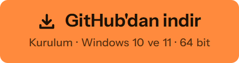</a>
  &nbsp;
  <a href="https://apps.microsoft.com/detail/9NL03GDZZ0ZS?referrer=appbadge&amp;mode=full"><picture><source media="(prefers-color-scheme: dark)" srcset="https://get.microsoft.com/images/tr%20light.svg"></picture></a>

  Ücretsiz · Resmî değildir, AJAZZ ile bağı yoktur · İki yolda da aynı uygulama: Store kopyasını Microsoft imzalar; GitHub'daki kurulum dosyası henüz imzalı değil, Windows çalıştırmadan önce uyarabilir: <a href="#indirme-ve-kurulum">hangisini seçmeli</a>

  
  
  
  

  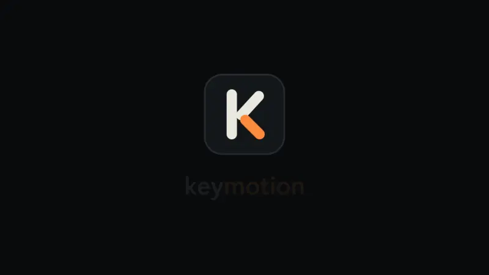
   
  Klavye sahneleri yapay zekâyla üretildi; uygulamanın sayfaları ve klavyenin ekranında görünenler gerçektir.
   
  <b>36 saniyelik sesli video (İngilizce): <a href="https://youtu.be/LvGvyJFhPIE">YouTube'da</a></b>

  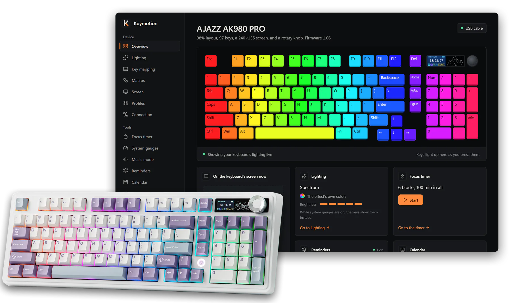

## Desteklenen klavyeler

Keymotion AJAZZ AK980 PRO'da denendi. Aynı altyapıyla yapılmış başka klavyeler de sırada olabilir; sizde biri varsa eklenmesine yardım edebilirsiniz.

### Denendi, çalışıyor

| | Klavye | USB kablo | 2.4 GHz alıcı | Bluetooth |
|---|---|---|---|---|
| 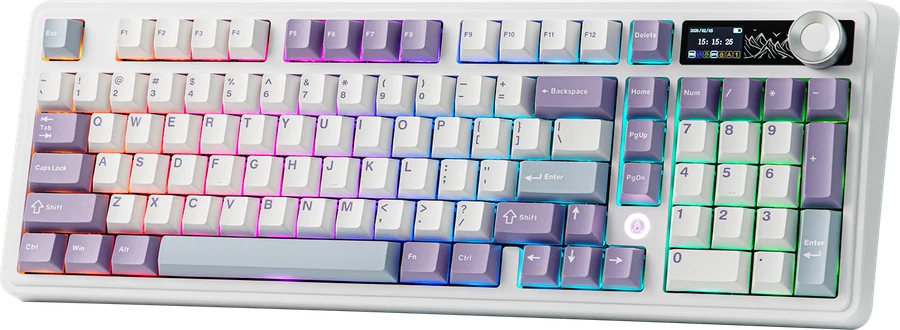 | **AJAZZ AK980 PRO** AK980 V2 adıyla da satılıyor | Her şey | Yazma, medya tuşları ve topuz | Yazma, medya tuşları, topuz ve pil düzeyi |

Ayarlar USB kablosundan gider; klavye böyle yapılmış.

> [!NOTE]
> AJAZZ'ın AK980 PRO için en yeni klavye yazılımı 3.01 ("AK980 Led v2 Firmware 769") farklı bir komut takımı kullanıyor; Keymotion bunu henüz desteklemiyor ve AJAZZ eski yazılıma dönmenin bir yolunu sunmuyor. Keymotion'ı şimdi kullanmaya devam etmek istiyorsanız güncellemeden önce bekleyin. [SSS'de ayrıntılar](https://cebersaban44-rgb.github.io/keymotion/tr/help/faq/#ajazzın-en-yeni-klavye-yazılımını-kurmalı-mıyım).

### Aynı altyapı, henüz denenmedi

Bu klavyeleri gerçek klavyelerde ölçen başka açık kaynak projelere göre, hepsi AK980 PRO ile aynı komutları kullanıyor görünüyor. Keymotion henüz bunlarla çalışmıyor: bir klavye ancak biri onu denedikten sonra eklenir, çünkü klavyeyi güvende tutan sınırlar modelden modele değişiyor.

Sizde var mı? Şöyle yardım edebilirsiniz:

1. [Keymotion'ı indirin](https://github.com/cebersaban44-rgb/keymotion/releases/latest) ve klavyeyi USB kablosuyla bağlayın.
2. Keymotion **Bu klavye henüz desteklenmiyor** derse **Destek iste**'yi seçin. Klavyenin bilgilerini kopyalar, klavyeye hiçbir şey yazmaz.
3. Aşağıda klavyenizin yanındaki **Bildirin** bağlantısını seçin ve bilgileri yapıştırın; formu Türkçe doldurabilirsiniz. Bu bilgilerle size denemeniz için bir sürüm hazırlayabiliriz.

| Klavye | Ekran | Durum | Sizde var mı? |
|---|---|---|---|
| **AULA F108 Pro** EPOMAKER x AULA F108 Pro adıyla da · en yakın akraba | 240×135 | Henüz denenmedi | [Bildirin][f108] |
| **AULA NOVA75** | 240×135 | Henüz denenmedi | [Bildirin][nova75] |
| **AULA F75 Max** EPOMAKER x AULA F75 Max adıyla da | 128×128 | Henüz denenmedi | [Bildirin][f75max] |
| **AULA EA75 Max** | 135×240, dikey | Henüz denenmedi | [Bildirin][ea75max] |
| **AULA S75 Pro** | 135×240, dikey | Henüz denenmedi | [Bildirin][s75pro] |
| **AULA F98 Pro** | 1,14 inç | Henüz denenmedi | [Bildirin][f98pro] |
| **AJAZZ AK820 Pro** SONiX programlı sürüm; EPOMAKER AK820 Pro adıyla da | 128×128 | Henüz denenmedi | [Bildirin][ak820pro] |
| **AJAZZ AK820 MAX / MAX PLUS** SONiX ekranlı sürüm | 128×128 | Henüz denenmedi | [Bildirin][ak820max] |
| **AJAZZ AK35I V3 MAX** | 240×135 | Henüz denenmedi | [Bildirin][ak35i] |
| **AJAZZ AKS075** | 128×128 | Henüz denenmedi | [Bildirin][aks075] |
| **AJAZZ AK650 / AK650 Pro** | 0,85 inç | Henüz denenmedi | [Bildirin][ak650] |
| **AJAZZ AK980** ekransız | Yok | Henüz denenmedi | [Bildirin][ak980] |
| **LangTu LT-104** | 160×80 | Henüz denenmedi | [Bildirin][lt104] |

Klavyeniz listede yok mu? Yine de takın ve [bize bildirin](https://github.com/cebersaban44-rgb/keymotion/issues/new?template=keyboard.yml). Her model hakkında bilinenler, birbirine benzeyip içi farklı olan klavyeler ve bir klavyenin **Henüz denenmedi**'den **Çalışıyor**'a nasıl geçtiği [Desteklenen klavyeler sayfasında](https://cebersaban44-rgb.github.io/keymotion/tr/help/keyboards/).

Bu klavyeler hakkında bildiklerimiz, onları ölçen başka açık kaynak projelerden geliyor; aralarında OpenKey, sonix-keyboard-studio, ak820pro-modder ve OpenRGB var. Ürün adları yalnızca hangi donanımdan söz edildiğini belirtmek için kullanılır; Keymotion bu markaların hiçbiriyle bağlantılı değildir.

[f108]: https://github.com/cebersaban44-rgb/keymotion/issues/new?template=keyboard.yml&title=%5BKeyboard%5D+AULA+F108+Pro&model=AULA+F108+Pro
[nova75]: https://github.com/cebersaban44-rgb/keymotion/issues/new?template=keyboard.yml&title=%5BKeyboard%5D+AULA+NOVA75&model=AULA+NOVA75
[f75max]: https://github.com/cebersaban44-rgb/keymotion/issues/new?template=keyboard.yml&title=%5BKeyboard%5D+AULA+F75+Max&model=AULA+F75+Max
[ea75max]: https://github.com/cebersaban44-rgb/keymotion/issues/new?template=keyboard.yml&title=%5BKeyboard%5D+AULA+EA75+Max&model=AULA+EA75+Max
[s75pro]: https://github.com/cebersaban44-rgb/keymotion/issues/new?template=keyboard.yml&title=%5BKeyboard%5D+AULA+S75+Pro&model=AULA+S75+Pro
[f98pro]: https://github.com/cebersaban44-rgb/keymotion/issues/new?template=keyboard.yml&title=%5BKeyboard%5D+AULA+F98+Pro&model=AULA+F98+Pro
[ak820pro]: https://github.com/cebersaban44-rgb/keymotion/issues/new?template=keyboard.yml&title=%5BKeyboard%5D+AJAZZ+AK820+Pro&model=AJAZZ+AK820+Pro
[ak820max]: https://github.com/cebersaban44-rgb/keymotion/issues/new?template=keyboard.yml&title=%5BKeyboard%5D+AJAZZ+AK820+MAX&model=AJAZZ+AK820+MAX
[ak35i]: https://github.com/cebersaban44-rgb/keymotion/issues/new?template=keyboard.yml&title=%5BKeyboard%5D+AJAZZ+AK35I+V3+MAX&model=AJAZZ+AK35I+V3+MAX
[aks075]: https://github.com/cebersaban44-rgb/keymotion/issues/new?template=keyboard.yml&title=%5BKeyboard%5D+AJAZZ+AKS075&model=AJAZZ+AKS075
[ak650]: https://github.com/cebersaban44-rgb/keymotion/issues/new?template=keyboard.yml&title=%5BKeyboard%5D+AJAZZ+AK650&model=AJAZZ+AK650
[ak980]: https://github.com/cebersaban44-rgb/keymotion/issues/new?template=keyboard.yml&title=%5BKeyboard%5D+AJAZZ+AK980+%28no+screen%29&model=AJAZZ+AK980+%28no+screen%29
[lt104]: https://github.com/cebersaban44-rgb/keymotion/issues/new?template=keyboard.yml&title=%5BKeyboard%5D+LangTu+LT-104&model=LangTu+LT-104

## Neler yapar

| | |
|---|---|
| 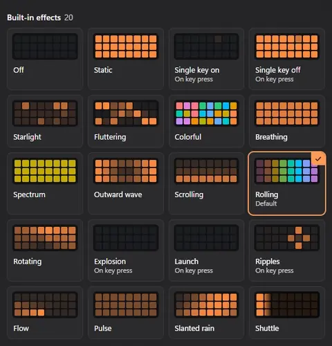 | **Işıklar** Klavyenin 19 efekti, her tuşa ayrı renk ve tuşlarda görünenin canlı aynası. |
| 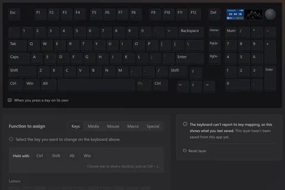 | **Tuş atama** Temel ve Fn katmanında her tuşu değiştirin: kısayollar, medya tuşları, fare düğmeleri. |
| 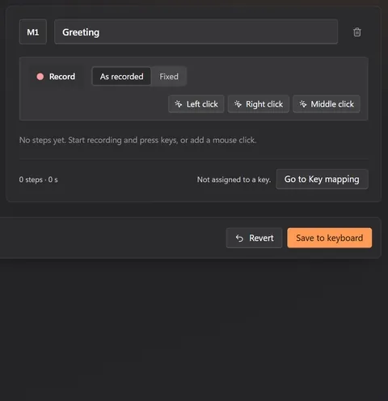 | **Makrolar** Tuşlara basarak bir dizi kaydedin, sonra her adımı ve süresini düzenleyin. |
| 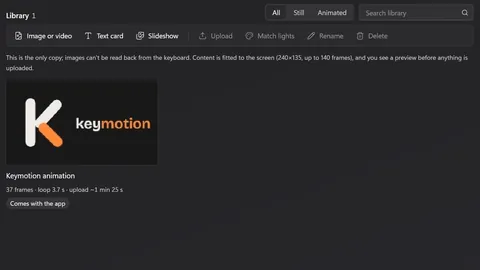 | **Ekran stüdyosu** 240×135 ekrana görsel, GIF, video ve yazı kartı koyun. |
| 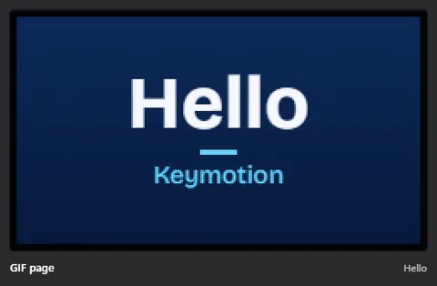 | **Canlı ekran** Kendiliğinden güncellenen kartlar: çalan şarkı, sıradaki toplantı, odak zamanlayıcısı. |
| 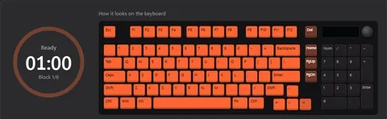 | **Odak ve hatırlatıcılar** Tuşlarda yanan odak zamanlayıcısı, hatırlatıcılar ve sistem göstergeleri. |
| 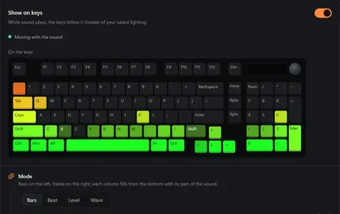 | **Müzik modu** Bilgisayarınızda çalan sese göre hareket eden tuş ışıkları: bastan tize çubuklar, her vuruşta bir nabız, bir ses yüksekliği şeridi ya da dalgalar. Ses kaydedilmez, mikrofon kullanılmaz. |
| 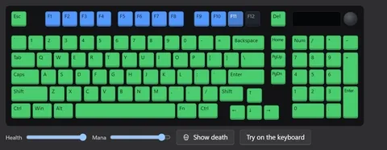 | **Oyun oturumu** Oynadığınızı fark eder: oyun başlarken ekrana bir kart, bitince bir özet gönderir ve oyunun tuşlarını yakar. League of Legends'ta canınız, mananız ve maçın olayları tuşlarda görünür. |
| 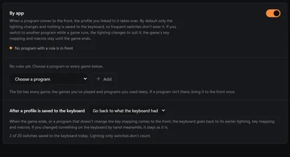 | **Uygulamaya göre profiller** Işığı, tuşları ve makroları profil olarak saklayın. Her program ya da bütün oyunlar öne gelince kendi profiline geçer. |

[Kullanım kılavuzu](https://cebersaban44-rgb.github.io/keymotion/tr/) uygulamanın her sayfasını tek tek anlatır.

## Yapay zekâ kodlama ajanları

Claude Code ya da Codex bir işi bitirince, onayınızı beklerken ya da hata verince klavyeniz ışıkla haber verebilir. Ajan tuşları kendi bildiği gibi de yakabilir: harf tuşlarında bir kelime, F sırasında bir ilerleme çubuğu. Bunu bir kez, **Araçlar › Yapay zekâ ajanları** sayfasında açarsınız: Keymotion her kodlama uygulamasına ne ekleyeceğini gösterir ve onayınızdan sonra bağlar.

Ajanlar Keymotion'la, uygulamayla birlikte gelen `keymotion-cli` komut satırı aracı üzerinden konuşur. Araç klavyeyi hiçbir zaman kendisi açmaz, yalnızca bu bilgisayarda sizin Windows kullanıcınız için çalışır ve siz ajan erişimini açana kadar hiçbir şey yapmaz. Ayrıntılar [Yapay zekâ ajanları rehberinde](https://cebersaban44-rgb.github.io/keymotion/tr/guide/ai-agents/); komutlar [Ajan komut satırı](https://cebersaban44-rgb.github.io/keymotion/tr/developers/agent-cli/) sayfasında.

## İndirme ve kurulum

Keymotion'ı iki yoldan kurabilirsiniz. İkisi de aynı uygulama; sürüm numarası ve sürüm notları da aynı. Windows 10 ve 11'de (64 bit) çalışır. Birini kurun.

| | Microsoft Store | GitHub |
|---|---|---|
| Nereden | [Microsoft Store'da Keymotion](https://apps.microsoft.com/detail/9NL03GDZZ0ZS?referrer=appbadge&mode=full) | [Son sürümün sayfasından](https://github.com/cebersaban44-rgb/keymotion/releases/latest) `Keymotion_<sürüm>_x64-setup.exe` |
| İmza | Var, Microsoft imzalar: Windows uyarı göstermeden kurar | Henüz yok: Windows çalıştırmadan önce uyarabilir |
| Güncellemeler | Microsoft Store | Keymotion GitHub'a bakar, kurmadan önce sorar |
| Deneme sürümleri | Yok | Var |

Önerimiz Microsoft Store. Bilgisayarınızda Microsoft Store yoksa (Windows LTSC ya da Store'u kapalı bir iş bilgisayarı) veya deneme sürümlerini denemek istiyorsanız GitHub'ı seçin.

**Microsoft Store'dan**

1. [Microsoft Store'da Keymotion](https://apps.microsoft.com/detail/9NL03GDZZ0ZS?referrer=appbadge&mode=full) sayfasını açıp **Al**'ı seçin.
2. Klavyeyi USB kablosuyla bağlayın ve arkasındaki anahtarı ortaya (USB) getirin.

**GitHub'dan**

1. Kurulum dosyasını, `Keymotion_<sürüm>_x64-setup.exe`, [son sürümün sayfasından](https://github.com/cebersaban44-rgb/keymotion/releases/latest) indirin. Dosyanın SHA-256 değeri aynı sayfada yazar.
2. Çalıştırıp adımları izleyin.
3. Klavyeyi USB kablosuyla bağlayın ve arkasındaki anahtarı ortaya (USB) getirin.

> [!NOTE]
> GitHub'daki kurulum dosyası henüz imzalı değil; Windows "Windows bilgisayarınızı korudu" diyebilir. **Ek bilgi**'yi, sonra **Yine de çalıştır**'ı seçin. Akıllı Uygulama Denetimi açıksa Windows kurulumu tamamen engelleyebilir; Microsoft Store kopyası ikisine de takılmadan kurulur. Ayrıntı için [kod imzalama politikasına](#kod-imzalama-politikası-code-signing-policy) bakın.

Kurmadan önce bilmeniz iyi olur:

- Keymotion resmî değildir. AJAZZ tarafından yapılmamış, onaylanmamış ve desteklenmez.
- İkisi de bu depodaki koddan GitHub Actions ile derlenir: SHA-256 özeti sürüm sayfasında yazan kurulum dosyası da, Microsoft'un denetleyip imzaladığı Store paketi de.
- VirusTotal'da 71 virüs tarama programından 70'i 0.1.0 kurulum dosyasında bir şey bulmuyor. Makine öğrenmesi kullanan tek bir program, yeni ve imzasız bir dosya olduğu için işaretliyor; yanlış alarm olarak bildirdik. [Ayrıntılar](https://cebersaban44-rgb.github.io/keymotion/tr/about/code-signing/#virüs-taramaları).
- Kullanım bilgisi toplamaz ve klavyenin yazılımını asla güncellemez.

Güncellemeler: Store'dan kurulan kopyayı Microsoft Store günceller. GitHub'dan kurulan kopya günde bir kez GitHub'da yeni sürüm olup olmadığına bakar ve kurmadan önce size sorar; bu denetimi Ayarlar'dan kapatabilirsiniz.

## Güvenlik

Keymotion yalnızca gerçek bir klavyede ölçülmüş komutları gönderir; klavye yazılımı ve önyükleyici güncellemeleri kodda engellidir. Işıklar, tuş atamaları, makrolar ve ekran görselleri klavyenin belleğine kaydedilir ve her zaman geri dönebilirsiniz: nasıl yapılacağı [Bir şey ters giderse](https://cebersaban44-rgb.github.io/keymotion/tr/help/recovery/) sayfasında.

## Gizlilik

Keymotion hakkınızda hiçbir bilgi toplamaz. Yalnızca iki iş için internete çıkar: eklerseniz takviminiz ve GitHub'da günde bir kez güncelleme denetimi (kapatılabilir). [Gizlilik politikasını](https://cebersaban44-rgb.github.io/keymotion/tr/about/privacy/) okuyun.

## Keymotion nasıl yapılıyor

Keymotion'ı bir yapay zekâ kodlama yardımcısı olan Claude ile yaptım. Kodun çoğunu Claude yazdı; ne yapacağına ben karar verdim ve her özelliği eklenmeden önce kendi AK980 PRO'mda denedim. Her değişiklik bir PR'dan ve otomatik denetimlerden geçer. Klavyeyle konuşan her şey önce gerçek klavyede ölçüldü; klavyeye zarar verebilecek komutlar kodda engelli.

## Kod imzalama politikası (Code signing policy)

GitHub'daki kurulum dosyası henüz imzalı değil. Açık kaynak projeleri ücretsiz imzalayan SignPath Foundation, 15 Kasım 2026'daki başvurumuzu proje henüz yeni olduğu için şimdilik kabul etmedi; yeniden başvuracağız. Keymotion ayrıca [Microsoft Store'da](https://apps.microsoft.com/detail/9NL03GDZZ0ZS?referrer=appbadge&mode=full); oradaki kopyayı Microsoft imzalar.

- Sürümler bu depodan GitHub Actions ile derlenir ([sürüm iş akışı](.github/workflows/release.yml)).
- Yazan ve inceleyen: [@cebersaban44-rgb](https://github.com/cebersaban44-rgb)
- Onaylayan: [@cebersaban44-rgb](https://github.com/cebersaban44-rgb)
- Gizlilik: [gizlilik politikası](https://cebersaban44-rgb.github.io/keymotion/tr/about/privacy/).

Politikanın tamamı: [Kod imzalama politikası](https://cebersaban44-rgb.github.io/keymotion/tr/about/code-signing/).

## Katkıda bulunma

Hata bildirimleri, klavye istekleri ve fikirler memnuniyetle karşılanır. Türkçe yazabilirsiniz:

- [Hata bildirin](https://github.com/cebersaban44-rgb/keymotion/issues/new?template=bug.yml)
- [Başka bir klavye isteyin](https://github.com/cebersaban44-rgb/keymotion/issues/new?template=keyboard.yml)
- [Sorular ve fikirler](https://github.com/cebersaban44-rgb/keymotion/discussions)
- [Güvenlik sorununu gizlice bildirin](SECURITY.md)

PR açmadan önce [katkı rehberini](https://cebersaban44-rgb.github.io/keymotion/tr/developers/contributing/) okuyun.

## Lisans

Keymotion, seçiminize göre [Apache Lisansı 2.0](LICENSE-APACHE) ya da [MIT lisansı](LICENSE-MIT) ile lisanslanmıştır. Uygulamadaki üçüncü taraf yazılımlar [app/public/third-party-notices.txt](app/public/third-party-notices.txt) dosyasında listelenir.

Keymotion bağımsız bir projedir. AJAZZ, AULA ya da burada adı geçen başka bir klavye markasıyla bağlantısı yoktur; onlar tarafından onaylanmamış ya da desteklenmemiştir. Ürün adları yalnızca uygulamanın hangi donanımla çalıştığını söylemek için kullanılır. [NOTICE](NOTICE) dosyasına bakın.

League of Legends ışıkları için Riot Games'in istediği not:

Keymotion isn't endorsed by Riot Games and doesn't reflect the views or opinions of Riot Games or anyone officially involved in producing or managing Riot Games properties. Riot Games, and all associated properties are trademarks or registered trademarks of Riot Games, Inc.
