

  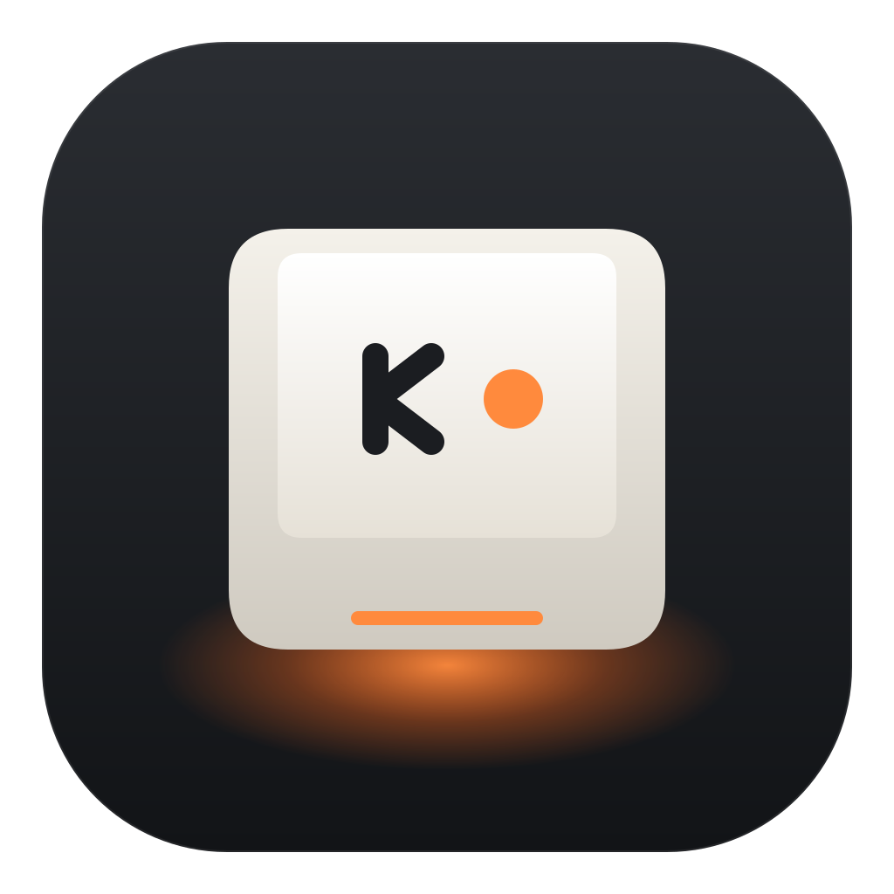

<h1 align="center">Keymotion</h1>

  适用于黑爵 AK980 V2（带屏版）键盘的免费开源 Windows 应用： 
  灯光、自定义按键、宏，还能在键盘的小屏幕上显示你自己的 GIF。无需黑爵官方驱动。 
  还有音乐模式、带英雄联盟灯光的游戏时段、按应用切换配置文件，以及 AI 编程智能体的灯光提醒。

  <b>用的是别的键盘？</b>AULA（狼蛛）、AJAZZ（黑爵）和 LangTu（狼途）的几款键盘可能会是下一批支持的型号。 
  <a href="#支持的键盘">你的键盘在列表中吗？</a>打开 Keymotion 后插上键盘，然后把它检测到的信息告诉我们。

  <a href="README.md">English</a> · <a href="README.tr.md">Türkçe</a> · <a href="README.ru.md">Русский</a> · <b>简体中文</b>

  本页中文版由 AI 辅助翻译。如果发现翻译有误，欢迎<a href="https://github.com/cebersaban44-rgb/keymotion/issues/new?template=docs.yml">报告翻译问题</a>。

  <b>
    <a href="https://cebersaban44-rgb.github.io/keymotion/zh-cn/">使用指南</a> ·
    <a href="https://github.com/cebersaban44-rgb/keymotion/releases">发行说明</a> ·
    <a href="https://github.com/cebersaban44-rgb/keymotion/discussions/categories/q-a">问答</a>
  </b>

  <a href="https://github.com/cebersaban44-rgb/keymotion/releases/latest">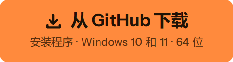</a>
  &nbsp;
  <a href="https://apps.microsoft.com/detail/9NL03GDZZ0ZS?referrer=appbadge&amp;mode=full"><picture><source media="(prefers-color-scheme: dark)" srcset="https://get.microsoft.com/images/zh-cn%20light.svg"></picture></a>

  免费 · 非官方的独立应用，与 AJAZZ（黑爵）无关 · 两种方式安装的是同一个应用：Microsoft Store 版由 Microsoft 签名，而 GitHub 上的安装程序尚未进行代码签名，因此运行前 Windows 可能会发出警告：<a href="#下载与安装">如何选择</a>

  
  
  
  

  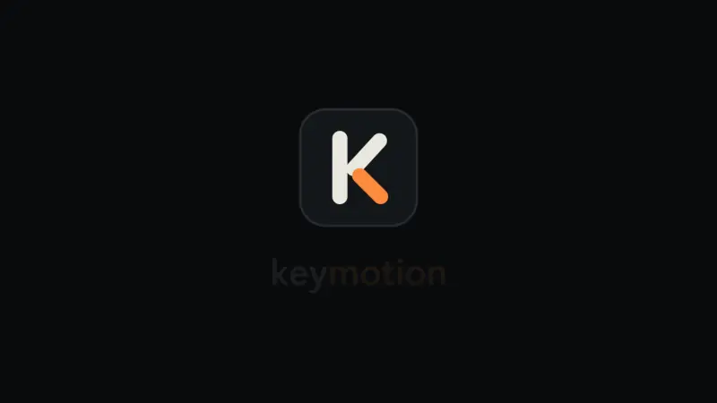
   
  键盘场景由 AI 生成；应用的页面和键盘屏幕上显示的内容都是真实的。
   
  <b>49 秒有声视频（英文）：<a href="https://youtu.be/7IcBu2ERSzA">在 YouTube 上观看</a></b>

  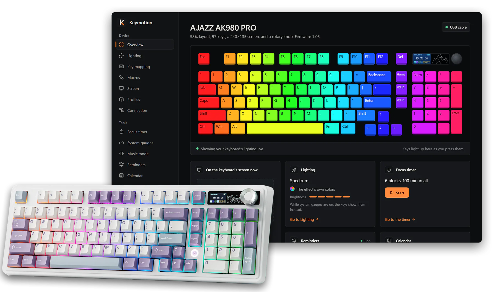

## 支持的键盘

Keymotion 已在黑爵 AK980 V2（带屏版）上测试。基于同一平台的其他键盘可能会是下一批支持的型号；如果你有这样的键盘，可以帮助我们添加对它的支持。

### 已测试，可以使用

| | 键盘 | USB 有线 | 2.4G 接收器 | 蓝牙 |
|---|---|---|---|---|
| 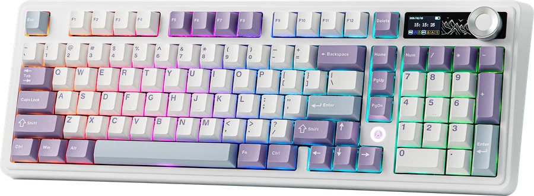 | **黑爵 AK980 V2（带屏版）** USB 名称为 SONiX AK980 PRO | 全部功能 | 打字、媒体键和旋钮 | 打字、媒体键、旋钮和电量 |

设置通过 USB 数据线传输：键盘本身就是这样设计的。

外观或名称相近的 2026 款 AK980 PRO（原生双 8K）和 AK980 MAX（磁轴）是不同的键盘，Keymotion 不支持。

> [!NOTE]
> 黑爵为 AK980 PRO 推出的最新固件 3.01（“AK980 Led v2 Firmware 769”）使用另一套命令。Keymotion 以测试版形式支持它，需通过 USB 数据线连接：这项支持是新的，还没有在真实键盘上试过。黑爵没有提供退回旧固件的方法，所以不要只为了 Keymotion 而安装它。[详见常见问题](https://cebersaban44-rgb.github.io/keymotion/zh-cn/help/faq/#要安装黑爵最新的固件吗)。

### 同一平台，尚未测试

根据其他开源项目在实物键盘上的测量结果，这些键盘似乎与黑爵 AK980 V2（带屏版）使用相同的指令。Keymotion 目前还不支持它们：只有在有人实际试过之后，才会添加一款键盘，因为保证键盘安全的各项限制因型号而异。

如果你有其中一款，可以这样帮忙：

1. [下载 Keymotion](https://github.com/cebersaban44-rgb/keymotion/releases/latest)，用 USB 数据线连接键盘。
2. 如果 Keymotion 显示**暂不支持此键盘**，选择**申请适配**。这会复制键盘的信息，不会向键盘写入任何内容。
3. 在下方表格中你的键盘旁边选择**告诉我们**，然后粘贴这些信息。有了这些信息，我们就能准备一个测试版本，供你在自己的键盘上试一下。

| 键盘 | 屏幕 | 状态 | 你有这款键盘吗？ |
|---|---|---|---|
| **AULA F108 Pro** 也有 EPOMAKER x AULA F108 Pro · 与已支持的键盘最相近 | 240×135 | 尚未测试 | [告诉我们][f108] |
| **AULA NOVA75** | 240×135 | 尚未测试 | [告诉我们][nova75] |
| **AULA F75 Max** 也有 EPOMAKER x AULA F75 Max | 128×128 | 尚未测试 | [告诉我们][f75max] |
| **AULA EA75 Max** | 135×240，竖屏 | 尚未测试 | [告诉我们][ea75max] |
| **AULA S75 Pro** | 135×240，竖屏 | 尚未测试 | [告诉我们][s75pro] |
| **AULA F98 Pro** | 1.14 英寸 | 尚未测试 | [告诉我们][f98pro] |
| **AJAZZ AK820 Pro** 使用 SONiX 程序的版本；也有 EPOMAKER AK820 Pro | 128×128 | 尚未测试 | [告诉我们][ak820pro] |
| **AJAZZ AK820 MAX / MAX PLUS** 带 SONiX 屏幕的版本 | 128×128 | 尚未测试 | [告诉我们][ak820max] |
| **AJAZZ AK35I V3 MAX** | 240×135 | 尚未测试 | [告诉我们][ak35i] |
| **AJAZZ AKS075** | 128×128 | 尚未测试 | [告诉我们][aks075] |
| **AJAZZ AK650 / AK650 Pro** | 0.85 英寸 | 尚未测试 | [告诉我们][ak650] |
| **AJAZZ AK980** 无屏幕版 | 无 | 尚未测试 | [告诉我们][ak980] |
| **LangTu LT-104** | 160×80 | 尚未测试 | [告诉我们][lt104] |

列表中没有你的键盘？也可以插上试试，然后[告诉我们](https://github.com/cebersaban44-rgb/keymotion/issues/new?template=keyboard.yml)。[支持的键盘](https://cebersaban44-rgb.github.io/keymotion/zh-cn/help/keyboards/)页面介绍了每款型号的已知情况、外观相似但内部不同的键盘，以及一款键盘如何从**尚未测试**变为**可用**。

这些键盘的信息来自对它们做过测量的其他开源项目，其中包括 OpenKey、sonix-keyboard-studio、ak820pro-modder 和 OpenRGB。提及产品名称只是为了说明所涉及的硬件；Keymotion 与这些品牌均无关联。

[f108]: https://github.com/cebersaban44-rgb/keymotion/issues/new?template=keyboard.yml&title=%5BKeyboard%5D+AULA+F108+Pro&model=AULA+F108+Pro
[nova75]: https://github.com/cebersaban44-rgb/keymotion/issues/new?template=keyboard.yml&title=%5BKeyboard%5D+AULA+NOVA75&model=AULA+NOVA75
[f75max]: https://github.com/cebersaban44-rgb/keymotion/issues/new?template=keyboard.yml&title=%5BKeyboard%5D+AULA+F75+Max&model=AULA+F75+Max
[ea75max]: https://github.com/cebersaban44-rgb/keymotion/issues/new?template=keyboard.yml&title=%5BKeyboard%5D+AULA+EA75+Max&model=AULA+EA75+Max
[s75pro]: https://github.com/cebersaban44-rgb/keymotion/issues/new?template=keyboard.yml&title=%5BKeyboard%5D+AULA+S75+Pro&model=AULA+S75+Pro
[f98pro]: https://github.com/cebersaban44-rgb/keymotion/issues/new?template=keyboard.yml&title=%5BKeyboard%5D+AULA+F98+Pro&model=AULA+F98+Pro
[ak820pro]: https://github.com/cebersaban44-rgb/keymotion/issues/new?template=keyboard.yml&title=%5BKeyboard%5D+AJAZZ+AK820+Pro&model=AJAZZ+AK820+Pro
[ak820max]: https://github.com/cebersaban44-rgb/keymotion/issues/new?template=keyboard.yml&title=%5BKeyboard%5D+AJAZZ+AK820+MAX&model=AJAZZ+AK820+MAX
[ak35i]: https://github.com/cebersaban44-rgb/keymotion/issues/new?template=keyboard.yml&title=%5BKeyboard%5D+AJAZZ+AK35I+V3+MAX&model=AJAZZ+AK35I+V3+MAX
[aks075]: https://github.com/cebersaban44-rgb/keymotion/issues/new?template=keyboard.yml&title=%5BKeyboard%5D+AJAZZ+AKS075&model=AJAZZ+AKS075
[ak650]: https://github.com/cebersaban44-rgb/keymotion/issues/new?template=keyboard.yml&title=%5BKeyboard%5D+AJAZZ+AK650&model=AJAZZ+AK650
[ak980]: https://github.com/cebersaban44-rgb/keymotion/issues/new?template=keyboard.yml&title=%5BKeyboard%5D+AJAZZ+AK980+%28no+screen%29&model=AJAZZ+AK980+%28no+screen%29
[lt104]: https://github.com/cebersaban44-rgb/keymotion/issues/new?template=keyboard.yml&title=%5BKeyboard%5D+LangTu+LT-104&model=LangTu+LT-104

## 功能

| | |
|---|---|
| 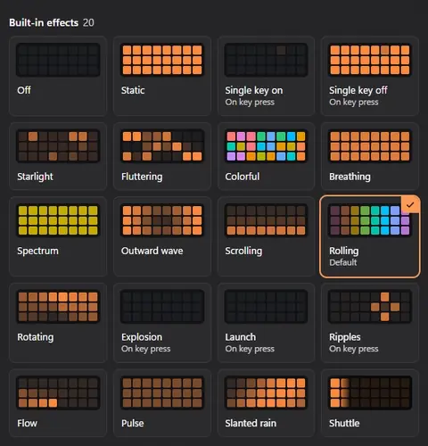 | **灯光** 键盘的 19 种灯效、为每个按键单独设置颜色，以及实时显示按键当前的灯光。 |
| 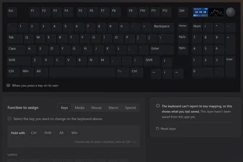 | **自定义按键** 更改基础层和 Fn 层上的任意按键：快捷键、媒体键、鼠标按键。 |
| 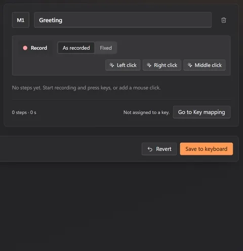 | **宏** 通过按键录制一段操作，然后编辑每个步骤及其时间。 |
| 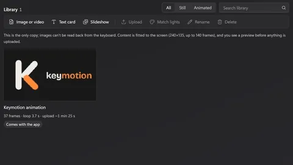 | **屏幕工作室** 把图片、GIF、视频和文字卡片放到 240×135 屏幕上。 |
| 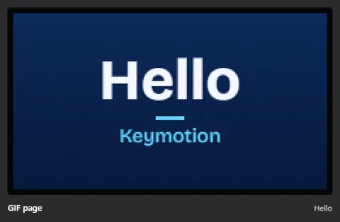 | **实时屏幕** 自动更新的卡片：正在播放的歌曲、你的下一个会议、专注计时器。 |
| 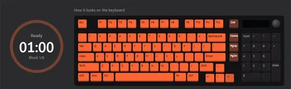 | **专注与提醒** 专注计时器、提醒，以及在按键上亮起的系统指标。 |
| 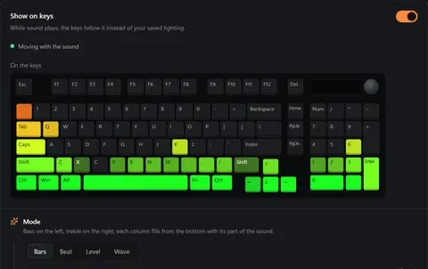 | **音乐模式** 随电脑播放的声音变化的按键灯光：从低音到高音的光柱、随每个节拍闪动的脉冲、一条表示响度的光带，或者波浪。不会录制声音，也不使用麦克风。 |
| 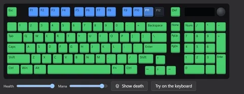 | **游戏时段** 识别你何时在玩游戏：游戏开始时在屏幕上显示一张卡片，结束时显示结算卡片，并点亮游戏用到的按键。在英雄联盟（League of Legends）中，你的生命值、法力值和对局中的事件会显示在按键上。国服（腾讯）未测试。 |
| 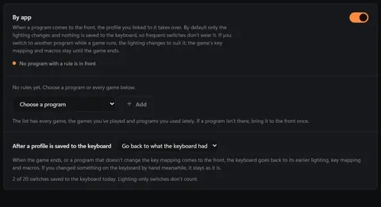 | **按应用切换配置文件** 将灯光、按键和宏保存为配置文件。每个程序（或所有游戏）来到前台时，都会切换到各自的配置文件。 |
|  | **AI 编程智能体** Claude Code 和 Codex 完成任务、等待你批准或出错时，用灯光告诉你；智能体还可以在按键上写字，或向屏幕发送卡片。[详见下文](#ai-编程智能体)。 |

[使用指南](https://cebersaban44-rgb.github.io/keymotion/zh-cn/)逐一介绍了应用的每个页面。

## AI 编程智能体

当 Claude Code 或 Codex 完成任务、等待你批准或出错时，键盘可以用灯光告诉你。智能体也可以按自己的方式点亮按键：在字母键上拼出一个词，在 F 键行显示进度条。只需在**工具 › AI 智能体**中开启一次：Keymotion 会显示它将为每个编程应用添加什么，经你批准后再连接。

智能体通过随应用提供的命令行工具 `keymotion-cli` 与 Keymotion 通信。它从不自己打开键盘，只为这台电脑上你的 Windows 用户工作，在你开启智能体访问之前什么也不做。详见 [AI 智能体指南](https://cebersaban44-rgb.github.io/keymotion/zh-cn/guide/ai-agents/)；命令见[智能体命令行](https://cebersaban44-rgb.github.io/keymotion/zh-cn/developers/agent-cli/)页面。

## 下载与安装

Keymotion 有两种获取方式。两者是同一个应用，版本相同，发行说明也相同，适用于 Windows 10 和 11（64 位）。安装其中一个即可。

| | Microsoft Store | GitHub |
|---|---|---|
| 获取方式 | [Microsoft Store 中的 Keymotion](https://apps.microsoft.com/detail/9NL03GDZZ0ZS?referrer=appbadge&mode=full) | 从[最新版本](https://github.com/cebersaban44-rgb/keymotion/releases/latest)页面下载 `Keymotion_<版本号>_x64-setup.exe` |
| 签名 | 有，由 Microsoft 签名：Windows 安装时不会发出警告 | 尚未签名：运行前 Windows 可能会发出警告 |
| 更新 | 由 Microsoft Store 更新 | Keymotion 会检查 GitHub，安装前会先询问你 |
| 测试版 | 无 | 有 |

我们推荐使用 Microsoft Store。如果你的电脑没有 Microsoft Store（例如 Windows LTSC，或已关闭 Microsoft Store 的工作电脑），或者你想尝试测试版，可以选择 GitHub。

**从 Microsoft Store 安装**

1. 打开 [Microsoft Store 中的 Keymotion](https://apps.microsoft.com/detail/9NL03GDZZ0ZS?referrer=appbadge&mode=full)，选择**获取**。
2. 用 USB 数据线连接键盘，并将键盘背面的开关拨到中间（USB 档）。

**从 GitHub 安装**

1. 从[最新版本](https://github.com/cebersaban44-rgb/keymotion/releases/latest)页面下载安装程序 `Keymotion_<版本号>_x64-setup.exe`。该页面列有它的 SHA-256 校验值。
2. 运行安装程序，按照步骤操作。
3. 用 USB 数据线连接键盘，并将键盘背面的开关拨到中间（USB 档）。

> [!NOTE]
> GitHub 上的安装程序尚未签名，因此 Windows 可能会显示“Windows 已保护你的电脑”。选择**更多信息**，然后选择**仍要运行**。如果开启了智能应用控制，Windows 可能会直接阻止它运行；安装 Microsoft Store 版时不会遇到这两种情况。参见[代码签名政策](#代码签名政策)。

安装前需要了解：

- Keymotion 是非官方的独立应用，并非由 AJAZZ（黑爵）开发、认可或提供支持。
- 两种版本都由 GitHub Actions 根据本仓库中的代码构建：安装程序（版本页面列有它的 SHA-256 校验值），以及由 Microsoft 检查并签名的 Microsoft Store 软件包。
- 在 VirusTotal 上，71 个杀毒引擎中有 70 个在 0.1.0 版安装程序中未发现任何问题。有一个基于机器学习的引擎把它标记为新的未签名文件；我们已将其作为误报提交。[详细信息](https://cebersaban44-rgb.github.io/keymotion/zh-cn/about/code-signing/#杀毒软件扫描)。
- 它不收集任何使用数据，也从不更新键盘的固件。

更新：Microsoft Store 版由 Microsoft Store 负责更新。GitHub 版每天在 GitHub 上检查一次新版本，安装前会先询问你；可以在“设置”中关闭这项检查。

## 安全

Keymotion 只发送在实物键盘上测量过的指令，固件和引导程序的更新已在代码中禁止。灯光、按键分配、宏和屏幕图片都保存在键盘的存储空间中，并且随时可以恢复到之前的状态：[出现问题时](https://cebersaban44-rgb.github.io/keymotion/zh-cn/help/recovery/)页面介绍了具体方法。

## 隐私

Keymotion 不收集任何关于你的信息。它只在两种情况下联网：获取你添加的日历，以及每天在 GitHub 上检查一次更新（可以关闭）。阅读[隐私政策](https://cebersaban44-rgb.github.io/keymotion/zh-cn/about/privacy/)。

## Keymotion 是如何开发的

我借助 AI 编程助手 Claude 开发了 Keymotion。大部分代码由 Claude 编写；我决定它应该做什么，并且每项功能在加入之前，我都在自己的键盘上亲自试过。每项更改都要经过拉取请求（pull request）和自动检查。所有与键盘通信的功能都先在实物键盘上测量过，可能损坏键盘的指令已在代码中禁止。

## 代码签名政策

GitHub 上的安装程序尚未签名。为开源项目免费提供签名的 SignPath Foundation 以项目仍较新为由，暂时拒绝了我们在 2026 年 11 月 15 日提交的申请；我们会再次申请。Keymotion 也已上架 [Microsoft Store](https://apps.microsoft.com/detail/9NL03GDZZ0ZS?referrer=appbadge&mode=full)，那里的版本由 Microsoft 签名。

- 发布版本由 GitHub Actions 根据本仓库构建（[发布工作流](.github/workflows/release.yml)）。
- 提交者和审阅者：[@cebersaban44-rgb](https://github.com/cebersaban44-rgb)
- 审批者：[@cebersaban44-rgb](https://github.com/cebersaban44-rgb)
- 隐私：参见[隐私政策](https://cebersaban44-rgb.github.io/keymotion/zh-cn/about/privacy/)。

完整政策：[代码签名政策](https://cebersaban44-rgb.github.io/keymotion/zh-cn/about/code-signing/)。

## 参与贡献

欢迎提交问题报告、键盘适配申请和想法：

- [报告问题](https://github.com/cebersaban44-rgb/keymotion/issues/new?template=bug.yml)
- [申请适配其他键盘](https://github.com/cebersaban44-rgb/keymotion/issues/new?template=keyboard.yml)
- [提问和建议](https://github.com/cebersaban44-rgb/keymotion/discussions)
- [私下报告安全问题](SECURITY.md)

提交拉取请求前，先阅读 [CONTRIBUTING.md](CONTRIBUTING.md)（英文）。

## 许可证

Keymotion 采用 [Apache License 2.0](LICENSE-APACHE) 或 [MIT 许可证](LICENSE-MIT)授权，你可以任选其一。应用中包含的第三方软件列在 [app/public/third-party-notices.txt](app/public/third-party-notices.txt) 中。

Keymotion 是一个独立项目，与 AJAZZ（黑爵）、AULA（狼蛛）或这里提到的任何其他键盘品牌均无关联，也未获得它们的认可或支持。提及产品名称只是为了说明本软件适用于哪些硬件。参见 [NOTICE](NOTICE)（英文）。

Riot Games 为英雄联盟灯光功能要求附上的声明：

Keymotion isn't endorsed by Riot Games and doesn't reflect the views or opinions of Riot Games or anyone officially involved in producing or managing Riot Games properties. Riot Games, and all associated properties are trademarks or registered trademarks of Riot Games, Inc.
